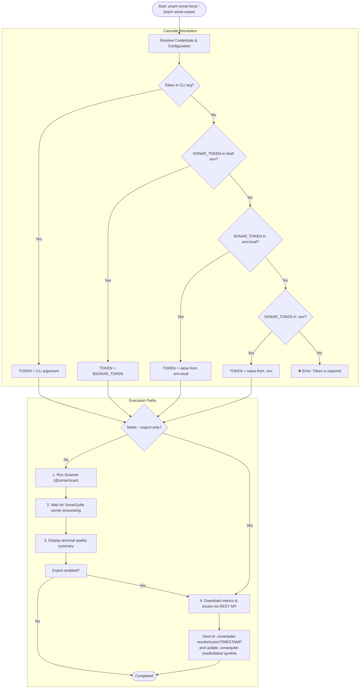

# SonarQube Quality Assurance & API Exporter

This guide documents the local static code analysis workflow, quality gates, and automated API reporting with SonarQube for the **ZIVAH International Website**.

---

## 1. Overview

The repository provides an automated scanner and API exporter script ([`scripts/sonarqube-scan.sh`](file:///home/iferpaz7/src/orgs/zivah-international/website/scripts/sonarqube-scan.sh)) designed to:

1. **Execute local scans:** Runs static analysis on Next.js 16, React 19, TypeScript, and Prisma code against your local SonarQube server (e.g. `http://localhost:9000`).
2. **Display immediate quality metrics:** Prints an immediate summary of bugs, vulnerabilities, code smells, test coverage, and Quality Gate status directly in your terminal.
3. **Export structured JSON artifacts:** Downloads full analysis metrics, unresolved issues, and quality-gate results into `.sonarqube-results/` for offline review, historical tracking, or AI assistant ingestion.
4. **Export-only mode (`--export-only`):** Fetches the latest SonarQube analysis without having to wait for a full scan re-execution.

---

## 2. Architecture & Execution Flow

The scanner automatically resolves credentials in a cascaded order (CLI argument > Shell environment > `.env.local` > `.env`), preventing accidental credential leaks in terminal history:



---

## 3. Environment Configuration

To keep sensitive tokens out of your terminal command history (`~/.bash_history`), configure credentials in `.env.local`:

```bash
# 1. Inspect the template
cat .env.example

# 2. Add SonarQube variables to your local .env.local
```

Add to [`.env.local`](file:///home/iferpaz7/src/orgs/zivah-international/website/.env.local):

```env
# --------------------------
# SONARQUBE (Local Scanner & API Exporter)
# --------------------------
SONAR_TOKEN="squ_your_sonarqube_token_here"
SONAR_HOST_URL="http://localhost:9000"
SONAR_PROJECT_KEY="zivah-international-website"
SONAR_PROJECT_NAME="ZIVAH International Website"
```

> [!NOTE]
> `.env.local` and `.env` are strictly excluded in `.gitignore`. Never commit tokens to source control.

---

## 4. Execution Commands

### A. Full Local Scan (`sonar:local`)

Executes the code scanner, polls SonarQube until analysis completes, renders the quality dashboard summary, and interactively offers to export results:

```bash
# Via pnpm script
pnpm sonar:local

# Directly via script
./scripts/sonarqube-scan.sh

# Automatically export without prompt
./scripts/sonarqube-scan.sh --export
```

### B. Export-Only Mode (`sonar:export`)

If the scan was already completed and you only need to download or refresh the JSON metrics and issues:

```bash
# Via pnpm script
pnpm sonar:export

# Directly via flag
./scripts/sonarqube-scan.sh --export-only
```

### C. Advanced CLI Flags

```bash
# Override token on the fly
./scripts/sonarqube-scan.sh squ_override_token

# Specify remote server or custom port
./scripts/sonarqube-scan.sh --server=http://sonar.internal:9000

# Specify custom project key
./scripts/sonarqube-scan.sh --project=zivah-international-website --export-only
```

---

## 5. Exported Results Structure

When export is triggered, artifacts are saved under `.sonarqube-results/scans/<YYYY-MM-DD_HH-mm-ss>/` and a symlink `.sonarqube-results/latest` is maintained:

```
.sonarqube-results/
├── latest -> scans/2026-10-08_23-00-00
└── scans/
    └── 2026-10-08_23-00-00/
        ├── measures.json        # High-level metrics (bugs, vulnerabilities, coverage, lines of code)
        ├── issues.json          # Complete list of unresolved issues, rules, and component paths
        ├── quality-gate.json    # Project Quality Gate status and condition checks
        ├── latest-analysis.json # Analysis execution history
        └── metadata.json        # Execution metadata (Git commit, branch, timestamp, SonarQube URL)
```

### Example `metadata.json`:

```json
{
  "projectKey": "zivah-international-website",
  "projectName": "ZIVAH International Website",
  "serverUrl": "http://localhost:9000",
  "scanDate": "2026-10-08T23:00:00.000Z",
  "git": {
    "commit": "abcdef123456...",
    "branch": "develop"
  },
  "exportPath": ".sonarqube-results/scans/2026-10-08_23-00-00"
}
```

---

## 6. Quality Gates & Clean Code Standards

Before opening pull requests or merging into `develop`/`main`:

1. **Quality Gate Status**: Must report `PASSED`.
2. **Reliability & Security Rating**: Must achieve `A` (0 open bugs and 0 vulnerabilities).
3. **Cognitive Complexity**: Function complexity must be ≤ 15 (`typescript:S3776`).
4. **Zero OWASP Top 10 Findings**: No unsanitized DOM injections, hardcoded credentials, or insecure external redirections.
